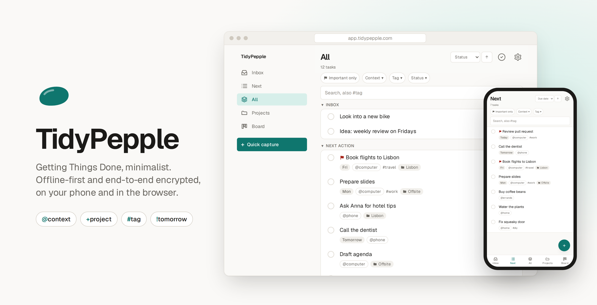

<p align="center">
  
</p>

<p align="center">
  A minimalist task manager based on Getting Things Done –<br>
  offline-first, end-to-end encrypted, on your phone and in the browser.
</p>

<p align="center">
  <a href="https://tidypepple.com"><strong>tidypepple.com</strong></a> ·
  <a href="https://app.tidypepple.com">Open the app</a> ·
  <a href="https://github.com/MelBourbon/tidypepple/issues">Feedback &amp; issues</a>
</p>

---

## Why TidyPepple

- **Offline-first.** The UI only ever reads and writes IndexedDB. The network is never in the
  request path, so the app works exactly the same in airplane mode. Everything except sync
  is free and stays on your device.
- **End-to-end encrypted sync.** The server only stores ciphertext. The vault key is wrapped
  with your passphrase (Argon2id) and a recovery key; every record is encrypted with
  AES-256-GCM and bound to its ID. Sync is free when you self-host. The hosted app at
  app.tidypepple.com offers it as a subscription.
- **Projects are not a separate type.** A task with an open step *is* a project. The action
  list never shows the project, only its next open step. When all steps are done, the project
  itself is back in “Next”.
- **Fast capture.** One line, plain text:

  ```
  Call Bob @phone +Moving #private !tomorrow >mon !!
  └ title ┘ └context┘ └project┘ └tag┘ └due┘ └start┘ └important┘
  ```

- **Installable PWA** for Android, iOS and desktop. German and English UI. The hosted version
  at tidypepple.com also offers an Android app; it is a thin wrapper around the PWA and not
  part of this repository.
- **API via MCP.** A local [MCP server](mcp/) lets Claude and other AI assistants or your own
  scripts read and edit tasks. It decrypts on your machine, so the server still sees only
  ciphertext.

## Quick start

Requires Node ≥ 22.

```bash
npm install
npm run dev        # dev server with hot reload
npm test           # unit tests (domain, crypto, sync, webhook)
npm run e2e        # end-to-end tests (phone and desktop emulation)
npm run build      # production build incl. service worker
```

Without a `.env` you get a purely local build: everything works except sync. To enable sync,
copy `.env.example` to `.env` and fill in your Supabase project, then turn off the
subscription requirement in the database. See [Self-hosting](docs/self-hosting.md).

## Architecture

```
src/domain/   pure logic, no IO: GTD rules, sorting, HLC, quick-add parser
src/data/     Dexie (IndexedDB) + repository; every mutation stamps an HLC and fills the outbox
src/crypto/   envelope encryption, vault key, recovery key
src/sync/     sync adapter, Supabase backend, push/pull/merge, subscription state
src/routes/   views
src/i18n/     all user-facing strings (de.ts is the reference, en.ts)
supabase/     database schema, edge functions (webhook), SQL tests
mcp/          MCP server (npm package and Claude Desktop extension)
deploy/       nginx config, database backup script
```

Every record carries a hybrid logical clock, every change goes through an outbox, and
deleting is always a soft delete. That is why sync could be added without a data migration.
The server resolves conflicts by comparing the opaque HLC column, without knowing the
content.

## Documentation

| Topic | |
|---|---|
| [Features](docs/features.md) | Capture syntax, lists, attachments, reminders, shortcuts |
| [Architecture](docs/architecture.md) | Data flow, HLC and outbox, tombstones, tests |
| [Encryption](docs/encryption.md) | Key hierarchy, attachments, what the server can see |
| [Self-hosting](docs/self-hosting.md) | Supabase setup, build, nginx, LAN testing |
| [Paid sync](docs/billing.md) | Optional: selling sync as a subscription (LemonSqueezy) |
| [API and MCP server](docs/mcp.md) | API tokens, tools, building the extension |
| [Restore](docs/restore.md) | Restoring the database from a backup |
| [Style guide](docs/styleguide.md) | Colors, typography, spacing |

## Contributing

Bug reports and ideas are welcome – both go to the
[GitHub issues](https://github.com/MelBourbon/tidypepple/issues). See
[CONTRIBUTING.md](CONTRIBUTING.md) before opening a pull request, and
[SECURITY.md](SECURITY.md) for reporting vulnerabilities.

## License

Copyright © 2026 TidyPepple. Licensed under the [AGPL-3.0](LICENSE). If you run a modified version as a service, you have to publish your
changes under the same license.
